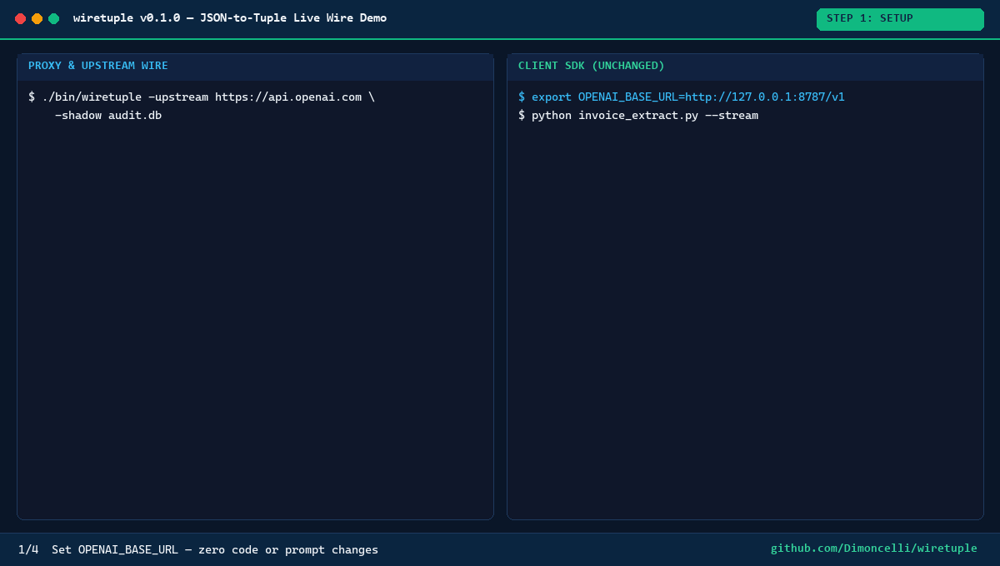

# wiretuple

**Cut 35–60 % of the output tokens of LLM Structured Outputs and Function
Calling — losslessly.** `wiretuple` is a single-binary HTTP reverse proxy
written in Go with zero external dependencies: your app keeps calling the same
API, and repeated JSON keys become positional tuples on the wire.



```
client ──► wiretuple ──► upstream API
              │
   request:  schema {"items":[{"id","total","currency"}]}
             rewritten to prefixItems + "Tuple: [id, total, currency]"
              │
   response: [["a1", 12.5, "EUR"], ["a2", 3, "USD"]]
             rehydrated to [{"id":"a1","total":12.5,"currency":"EUR"}, ...]
              │
              └─ incremental SSE rehydration, same bytes downstream
```

## Why

A schema that asks for 40 line items with 7 fields makes the model emit the same
seven key names 40 times. Those keys are pure overhead: the receiver already
knows them from the schema. `wiretuple` moves the key list into one legend and
sends values as positions.

## Install

```bash
go build -trimpath -ldflags="-s -w" -o bin/wiretuple ./cmd/wiretuple
```

No `go.mod` requirements, no cgo, no runtime data files.

## Quickstart

```bash
# OpenAI-compatible client
export OPENAI_BASE_URL=http://127.0.0.1:8787/v1
./bin/wiretuple -upstream https://api.openai.com

# Anthropic-compatible client
export ANTHROPIC_BASE_URL=http://127.0.0.1:8787
./bin/wiretuple -upstream https://api.anthropic.com
```

Flags:

| Flag | Default | Meaning |
|---|---|---|
| `-upstream` | – | upstream base URL (required) |
| `-listen` | `127.0.0.1:8787` | listen address |
| `-break-even` | `5.0` | minimum net savings (%) to rewrite a schema |
| `-legend-tokens` | `0` | fixed legend cost (0 = estimate) |
| `-activate` | `true` | master switch |
| `-shadow <path>` | – | passive audit into a SQLite file |
| `-max-body` | `4 MiB` | request body limit |

## Protocol coverage

| Provider | Endpoint | Structured output | Function calling |
|---|---|---|---|
| OpenAI | `/v1/chat/completions` | `response_format.json_schema.schema` | `tools[].function.parameters` |
| Anthropic | `/v1/messages` | tool schema in `input_schema` | `tools[].input_schema` |

Both `stream: false` (recomputed `Content-Length`) and `stream: true` (SSE,
rehydrating only the JSON fragments) are covered. Anything that is not JSON
(for example `[DONE]` or a non-JSON event) is forwarded byte for byte.

## Break-even gate

Small payloads are not worth a legend. The gate estimates saved output tokens
against the fixed legend cost and keeps the request byte-identical when net
savings are below `-break-even`:

```
net_savings_% = (tokens_before - tokens_after - legend_tokens) / tokens_before * 100
```

A single flat object usually stays untouched; a repeated object array with long
keys activates.

## Passive audit (`--shadow`)

```bash
./bin/wiretuple -upstream https://api.openai.com -shadow audit.db
```

Traffic passes through untouched. Each request/response pair is simulated and
appended to a zero-dependency SQLite 3 file, readable with any SQLite client:

```sql
SELECT count(*), avg(net_savings_pct) FROM shadow_records;
```

The console prints a summary on shutdown:
`rows`, `activated`, `activation_rate`, `tokens_before`, `tokens_after`,
`output_savings`, `net_savings`.

## Benchmarks

Deterministic scenarios (e-commerce invoice, dev-tool pull request batch, MCP
tool definitions) with structural equality asserted after rehydration:

```
$ make bench
| Scenario | tokens_before | tokens_after | output_savings_% | net_savings_% | p99_overhead_ms | equality |
|---|---:|---:|---:|---:|---:|---|
| E-commerce invoice line items | 2041 | 801 | 60.8% | 59.2% | 0.095 | OK |
| Dev-tool pull request batch | 1602 | 889 | 44.5% | 43.0% | 0.078 | OK |
| MCP tool invocations batch | 1617 | 711 | 56.0% | 53.7% | 0.084 | OK |
```

Token counts use a deterministic size model (one token per four UTF-8 bytes),
so the table is reproducible without an API key. Equality is checked with
`reflect.DeepEqual` on decoded values plus legend key order.

## How it works

- `internal/compiler` — lossless `SchemaNode`, deterministic key order
  (`required` first, then lexicographic), tuple schemas with `prefixItems` and
  `items: false` (Draft 2020-12, accepted by structured-output APIs that reject
  `additionalItems`), nested tuples, and the rehydration tree.
- `internal/gate` — break-even estimator with an injectable token model.
- `internal/rehydrator` — byte-level state machine; handles UTF-8 split across
  chunks, escaped quotes/backslashes, brackets and commas inside strings,
  nested tuples, and degrades to raw output on shape violations without
  breaking the stream.
- `internal/proxy` — reverse proxy, provider detection, SSE codec, bounded
  bodies, upstream-only forwarding, cancellation.
- `internal/shadow` — passive audit plus a pure-Go SQLite 3 writer.

## Development

```bash
make test    # go test ./...
make race    # go test -race ./...
make bench   # savings table + equality checks
make build   # bin/wiretuple, bin/wiretuple-bench
make vet
```

## License

MIT © 2026 Dimoncelli.
